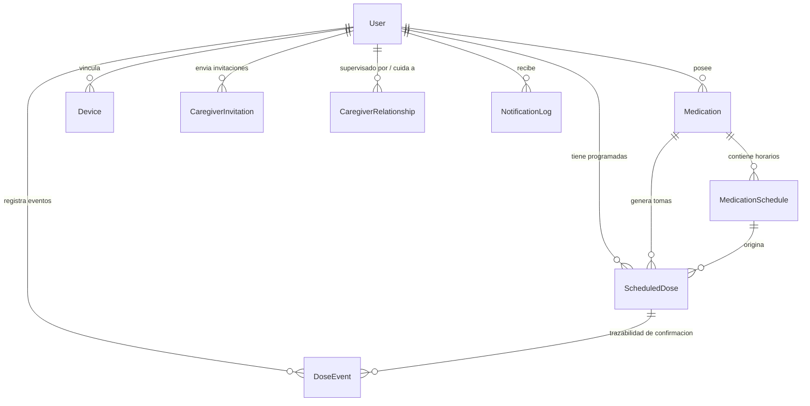

# Esquema de Base de Datos Relacional — MediSync

MediSync utiliza **Prisma ORM** sobre SQLite (modo desarrollo sin dependencias externas) y es compatible con **PostgreSQL**.

---

## 1. Diagrama Entidad-Relación (Mermaid)

---

## 2. Descripción de Entidades

### `User`
- `id` (UUID, PK)
- `email` (String, Unique)
- `passwordHash` (String, bcrypt)
- `fullName` (String)
- `phone` (String, Nullable)
- `emergencyContact` (String, Nullable)
- `timezone` (String, default "America/Mexico_City")
- `role` (String: "PATIENT", "CAREGIVER", "ADMIN")
- `createdAt`, `updatedAt`

### `Medication`
- `id` (UUID, PK)
- `userId` (UUID, FK -> User.id, Cascade)
- `name` (String)
- `description` (String, Nullable)
- `dosage` (String)
- `unit` (String: "mg", "ml", "tabletas", "gotas", etc.)
- `frequency` (String: "DIARIO", "CADA_8_HORAS", etc.)
- `instructions` (String, Nullable)
- `startDate` (DateTime)
- `endDate` (DateTime, Nullable)
- `imageUrl` (String, Nullable)
- `color` (String, Hex)
- `isActive` (Boolean, default true)

### `MedicationSchedule`
- `id` (UUID, PK)
- `medicationId` (UUID, FK -> Medication.id, Cascade)
- `timeOfDay` (String, formato "HH:mm")
- `daysOfWeek` (String: "1,2,3,4,5,6,7")
- `remindersEnabled` (Boolean, default true)
- `snoozeIntervalMinutes` (Int, default 10)

### `ScheduledDose`
- `id` (UUID, PK)
- `userId` (UUID, FK -> User.id, Cascade)
- `medicationId` (UUID, FK -> Medication.id, Cascade)
- `scheduleId` (UUID, FK -> MedicationSchedule.id, SetNull)
- `scheduledTime` (DateTime)
- `status` (String: "PENDING", "CONFIRMED", "SNOOZED", "LATE", "SKIPPED")
- `snoozedUntil` (DateTime, Nullable)

### `DoseEvent`
- `id` (String, PK — UUID de evento para idempotencia)
- `scheduledDoseId` (UUID, FK -> ScheduledDose.id, Cascade)
- `userId` (UUID, FK -> User.id, Cascade)
- `eventType` (String: "CONFIRMED", "SNOOZED", "SKIPPED")
- `confirmedAt` (DateTime)
- `deviceSource` (String: "PHONE", "SMARTWATCH_WEAROS", "SMARTWATCH_SIMULATOR", "WEB")
- `notes` (String, Nullable)
- `syncStatus` (String: "SYNCED", "PENDING")

### `CaregiverInvitation`
- `id` (UUID, PK)
- `patientId` (UUID, FK -> User.id, Cascade)
- `inviteeEmail` (String)
- `inviteCode` (String, Unique, 6 caracteres alfanuméricos)
- `status` (String: "PENDING", "ACCEPTED", "REJECTED", "EXPIRED")
- `expiresAt` (DateTime)

### `CaregiverRelationship`
- `id` (UUID, PK)
- `patientId` (UUID, FK -> User.id, Cascade)
- `caregiverId` (UUID, FK -> User.id, Cascade)
- `permissions` (String: "VIEW_MEDICATIONS,VIEW_DOSES,RECEIVE_ALERTS")
- `isActive` (Boolean, default true)
- `alertDelayMinutes` (Int, default 30)
- Unique: `[patientId, caregiverId]`

### `Device`
- `id` (UUID, PK)
- `userId` (UUID, FK -> User.id, Cascade)
- `deviceType` (String: "PHONE", "SMARTWATCH_WEAROS", "SMARTWATCH_SIMULATOR")
- `deviceName` (String)
- `deviceIdentifier` (String)
- `batteryLevel` (Int, Nullable)
- `lastSyncAt` (DateTime, Nullable)
- `isConnected` (Boolean, default false)
- Unique: `[userId, deviceIdentifier]`

