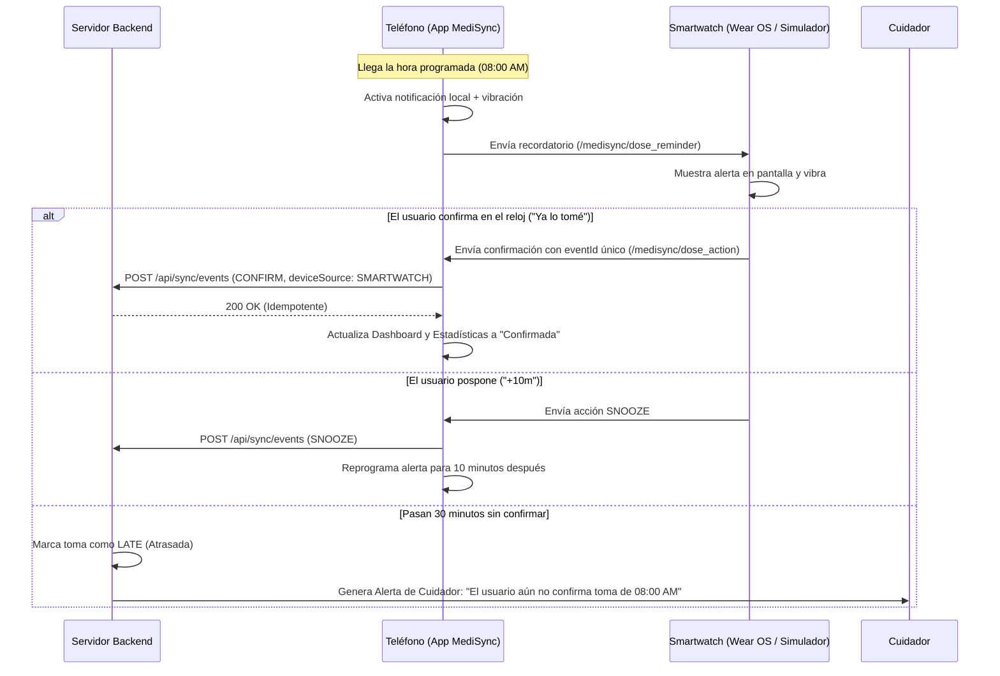

# Integración y Simulación de Smartwatch — MediSync

## 1. Visión General de la Integración

MediSync está diseñado para funcionar en dos modalidades complementarias:
1. **Dispositivos Wear OS Reales (Hardware)**: Vía Google Play Services Wearable Data Layer (`/medisync/*`).
2. **Simulador de Smartwatch Integrado (Software)**: Interfaz gráfica interactiva y funcional dentro de la app móvil para pruebas inmediatas sin hardware físico.

---

## 2. Flujo de Notificación y Confirmación

---

## 3. Garantía de Idempotencia y Manejo Offline

Para prevenir que una misma toma se registre dos veces (por ejemplo, si el reloj reintenta la sincronización por pérdida momentánea de Bluetooth):
1. El cliente (reloj o simulador) genera un `eventId` con formato `watch_<timestamp>_<random>`.
2. El backend busca en la tabla `DoseEvent` si ya existe un registro con dicho `id`.
3. Si existe, responde con status `DUPLICATE_IGNORED` sin volver a modificar el contador ni la fecha de confirmación.
4. Si la app no tiene conexión a Internet, el evento se guarda en la cola local de `AsyncStorage` (`@medisync_pending_events`) y se envía automáticamente al reanudar la señal mediante `SmartwatchService.flushPendingQueue()`.

---

## 4. Modo de Demostración Rápida (1 Minuto)

Para evaluar todo el flujo sin esperar horas:
1. En la pantalla principal o en el simulador, presiona **"⚡ Programar toma de prueba en 1 minuto"**.
2. MediSync registrará un horario temporal para 60 segundos después.
3. Al cumplirse el minuto:
   - Se reproduce la vibración háptica.
   - En el Simulador de Smartwatch aparece la pantalla de alerta con los botones de acción inmediata.
   - Al pulsar **"✓ Ya lo tomé"**, la toma pasa a estado confirmada y el porcentaje de cumplimiento del día sube en tiempo real.

